<div align="center">

# Adhkār · أذكار

**Remembrance for every moment: adhkār, prayer, Jumuʿah, Ramaḍān and the Hijri year.**<br>
On Android and Windows. Works offline. No ads, no account, no tracking. Free and open source, built as ṣadaqah jāriyah.

[](https://github.com/Bashyr18/adhkar/releases/latest)
[](https://bashyr18.github.io/adhkar/guide/#get)
[](https://github.com/Bashyr18/adhkar/actions/workflows/test.yml)
[](LICENSE)

[](https://github.com/Bashyr18/adhkar/releases/latest/download/Adhkar.apk)
[](https://github.com/Bashyr18/adhkar/releases/latest/download/Adhkar-Setup.exe)
[](https://bashyr18.github.io/adhkar/guide/)
[](https://www.linkedin.com/in/bashirbadmus/)

[**Download**](#download) · [**Is it safe?**](#is-it-safe) · [**The guide**](#the-illustrated-guide) · [**How to use it**](#how-to-use-it) · [**Build it yourself**](#build-it-yourself) · [**The maker**](#the-maker)

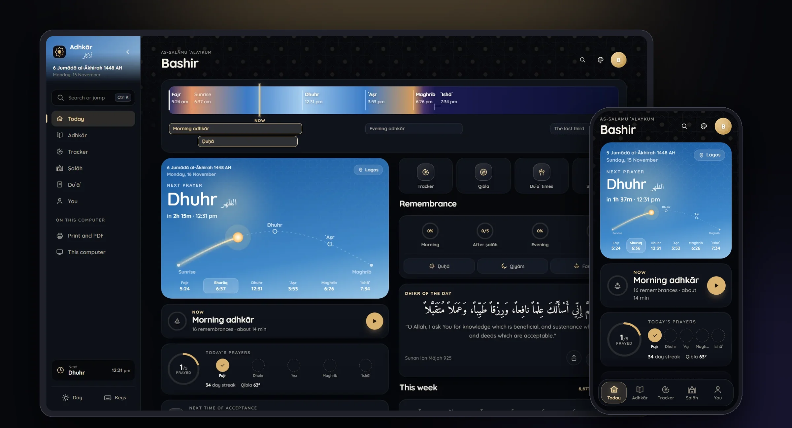

</div>

## Contents

- [What it is](#what-it-is)
- [Download](#download) · [Is it safe?](#is-it-safe) · [Updates](#updates)
- [The illustrated guide](#the-illustrated-guide)
- [A look inside](#a-look-inside)
- [How to use it](#how-to-use-it)
- [Sources and privacy](#sources-and-privacy)
- [Build it yourself](#build-it-yourself) · [Tests](#tests) · [Where things live](#where-things-live) · [Contributing](#contributing)
- [The maker](#the-maker) · [Licence](#licence)

## What it is

One calm place for the whole day's remembrance. Today leads with what is due now: the morning adhkār after Fajr, the evening adhkār from ʿAṣr, the next prayer, and the times when duʿāʾ is answered. Every collection of Ḥiṣn al-Muslim is there, read in a reader set like a muṣḥaf, counted on your fingers as the Sunnah teaches.

- **Religious text from verified sources only.** Arabic word for word from Ḥiṣn al-Muslim and the Qurʾān; translations labelled "Translation", verbatim; every hadith with its grade.
- **The Sunnah shapes the design.** The app keeps the pace while your right hand keeps the count. The basmalah always stands on its own line. No music: only the human adhān.
- **Through the week and the year.** A Jumuʿah mode from Thursday Maghrib with Sūrat al-Kahf, a Ramaḍān mode for the whole month, and the Hijri calendar with its Sunnah fasts.
- **Every screen.** Phones from a flip's cover screen up; on a tablet or an opened foldable it turns with you and lays out beside a side rail in balanced columns, switching back the moment the phone is folded; on Windows, a desktop app of its own.
- **Private.** Prayer times are worked out on the device. Nothing needs an account, and nothing leaves the device unless you choose to download a recitation.

## Download

| | |
|---|---|
| **Android** 8 or newer, phones, tablets and foldables | [**Download `Adhkar.apk`**](https://github.com/Bashyr18/adhkar/releases/latest/download/Adhkar.apk) (about 4 MB), open it on the phone and allow the install. |
| **Windows** 10 or 11 | [**Download `Adhkar-Setup.exe`**](https://github.com/Bashyr18/adhkar/releases/latest/download/Adhkar-Setup.exe) (about 4 MB), open it and choose **Install**. Adhkār goes in its own folder, in Start, on your desktop and in **Settings › Apps**, for you only with no administrator needed, and updates itself from inside the app. (`Adhkar-Windows.exe` on the release page is the same app as one file that runs without installing.) |

Every file, with its SHA-256 checksum, is on the [releases page](https://github.com/Bashyr18/adhkar/releases/latest). The [guide](https://bashyr18.github.io/adhkar/guide/#install) shows each install screen, step by step.

### Is it safe?

Adhkār comes from this page, not an app store, so Android and Windows ask you to confirm before installing it. That warning appears for **every** app from outside a store, and for every new Windows program without a paid signing certificate. It is not a finding about Adhkār.

- **Open source:** every line is here to read.
- **Nothing taken:** no ads, no analytics, no account. It never reads your contacts, messages or files.
- **Check it yourself:** compare the file's SHA-256 with the one on the release page, let Google Play Protect scan it, or upload it to [VirusTotal](https://www.virustotal.com/).
- **On Android:** Android asks once to allow your browser to install apps, then **Install**. If Play Protect offers to scan it, let it; if it says it doesn't recognise the developer, choose **Install anyway**.
- **On Windows:** if Windows says it protected your PC, click **More info**, check the name reads `Adhkar-Setup.exe`, then **Run anyway**.

<a href="https://bashyr18.github.io/adhkar/guide/#install">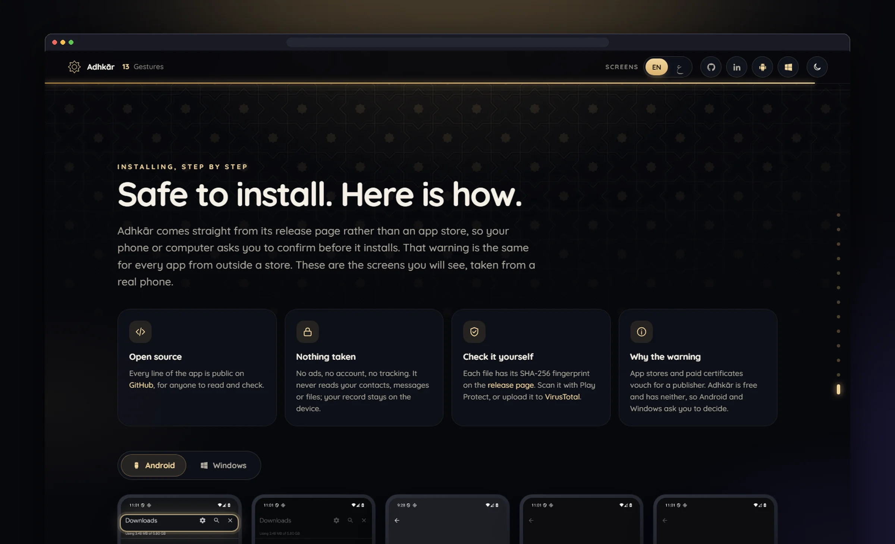</a>

### Updates

Open **You › About** and tap **Check now**, or turn on **Check once a week**. When a new version is out, a small gold **Update** key appears on Today (and in the rail on a computer). The file comes from the release page and is checked against its SHA-256 before anything changes; on Android, Android itself refuses an update not signed with the same key. Nothing is checked unless you ask. A copy from Google Play is updated by Play.

## The illustrated guide

<a href="https://bashyr18.github.io/adhkar/guide/">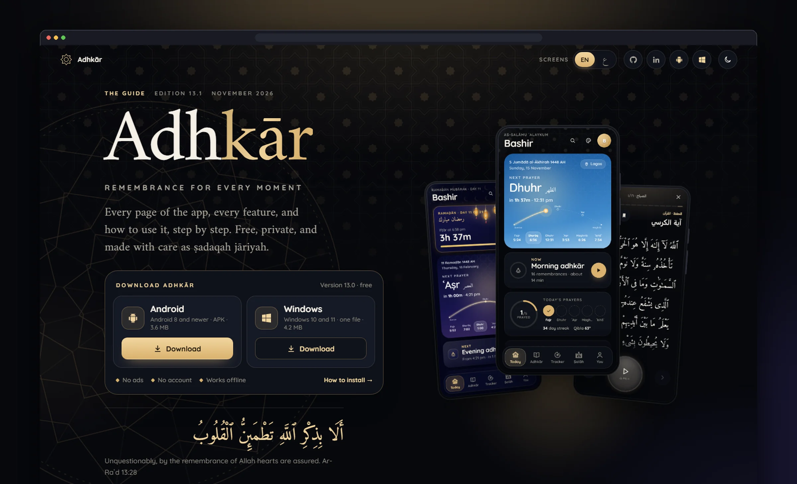</a>

**[Open the guide →](https://bashyr18.github.io/adhkar/guide/)**

Every screen of the app, on the phone and the computer, with each feature marked and explained step by step.

| | |
|---|---|
| **Thirteen chapters** | From Today to the home-screen widgets, in the order you meet them. |
| **Guided tours** | Press **Walk me through** on any screen and the guide shows each step in turn. |
| **Phone and computer** | Each chapter shows the phone screen and, beneath it, the same page laid out on a computer. |
| **Day, night and Arabic** | The same pages in the light theme, the dark theme and in العربية. |
| **Made for your phone too** | On a phone the screen stays pinned while its steps scroll beneath it; screens and steps swipe. |

## A look inside

### Your day

<table>
<tr>
<td width="33%">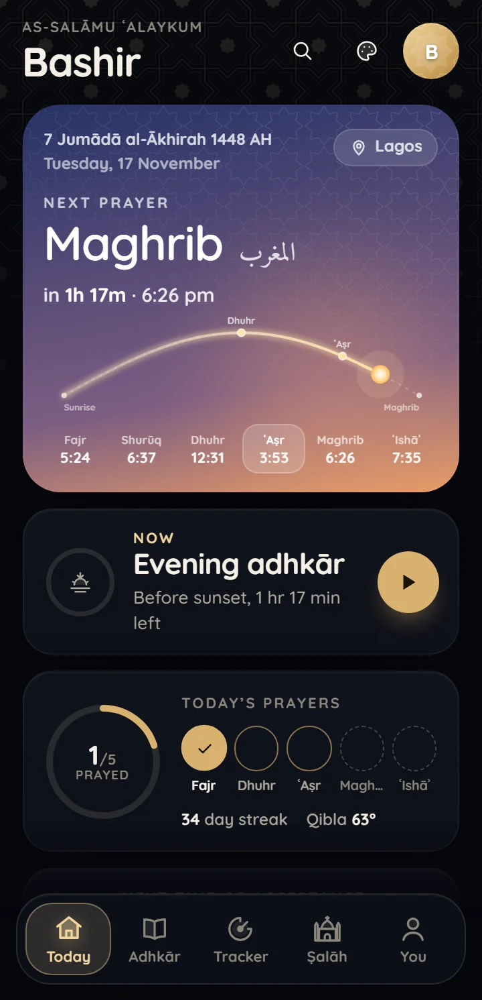</td>
<td width="33%">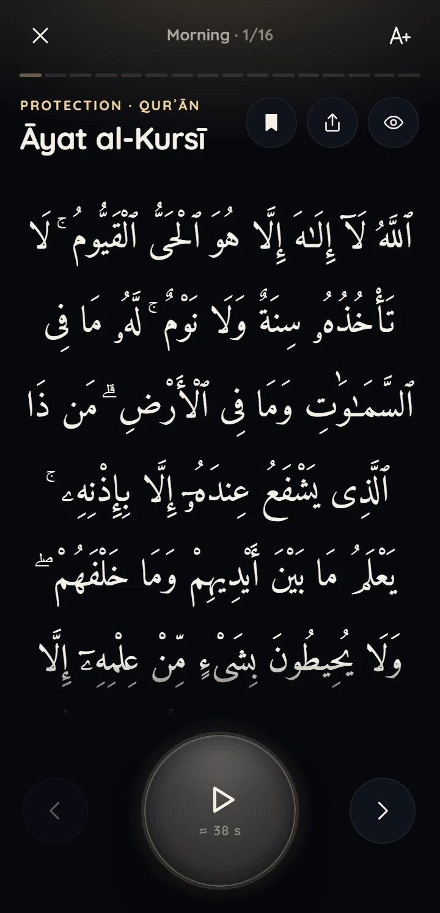</td>
<td width="33%">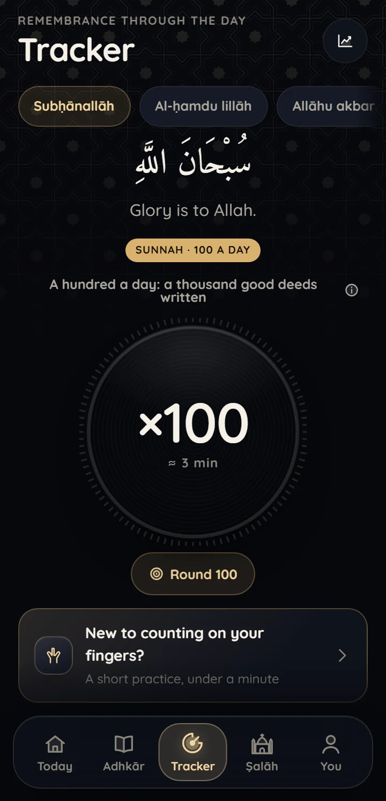</td>
</tr>
<tr>
<td><b>Today</b><br>The next prayer on the day's sky, what is due now, your prayers and the next time of acceptance.</td>
<td><b>The reader</b><br>One remembrance at a time, set like a muṣḥaf, with its transliteration, translation and source.</td>
<td><b>The Tracker</b><br>Free remembrance with the numbers the Sunnah sets, counted on your fingers.</td>
</tr>
</table>

### Prayer

<table>
<tr>
<td width="33%">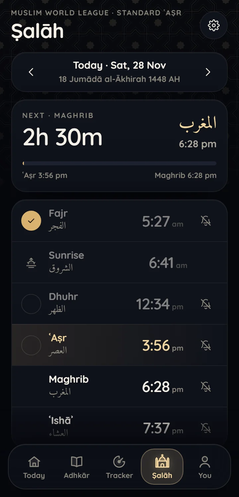</td>
<td width="33%">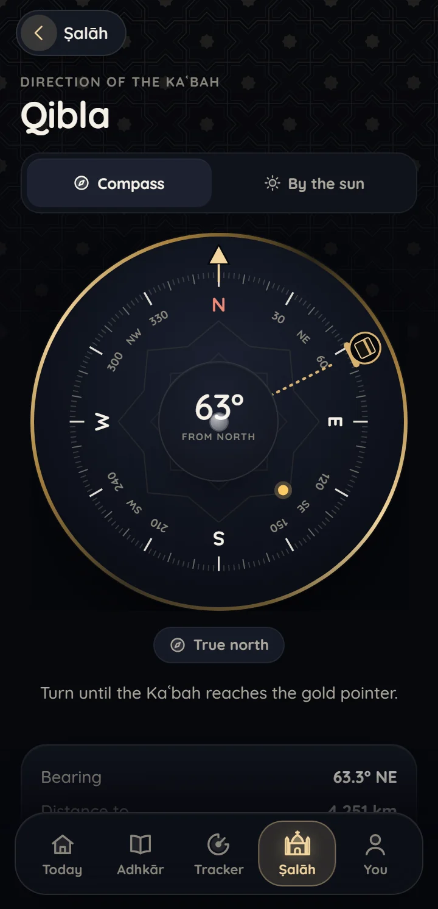</td>
<td width="33%">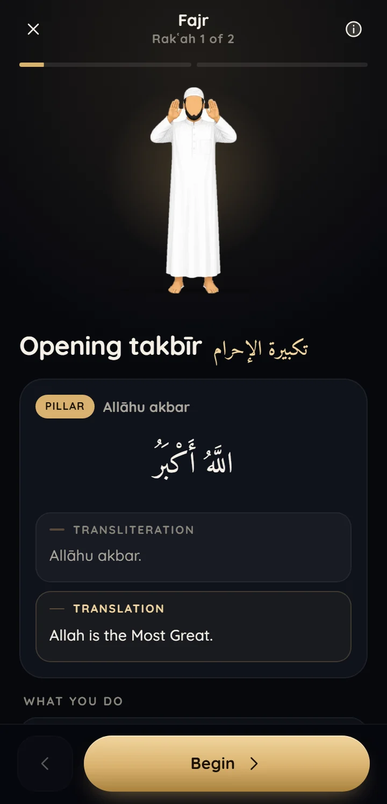</td>
</tr>
<tr>
<td><b>Ṣalāh</b><br>Prayer times anywhere, offline; Ḍuḥā and the last third; make-up prayers and iqāmah.</td>
<td><b>The qibla</b><br>A compass that turns to the Kaʿbah, or the sun's direction when the compass can't be trusted.</td>
<td><b>Learn the prayer</b><br>Step by step, as the Prophet ﷺ prayed, with the words and the evidence for each posture.</td>
</tr>
</table>

### Jumuʿah and Ramaḍān

<table>
<tr>
<td width="33%">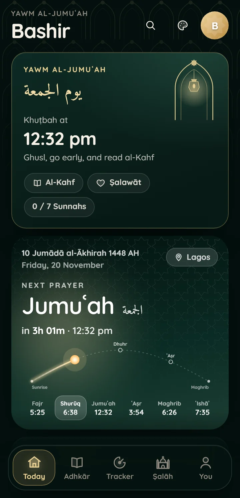</td>
<td width="33%">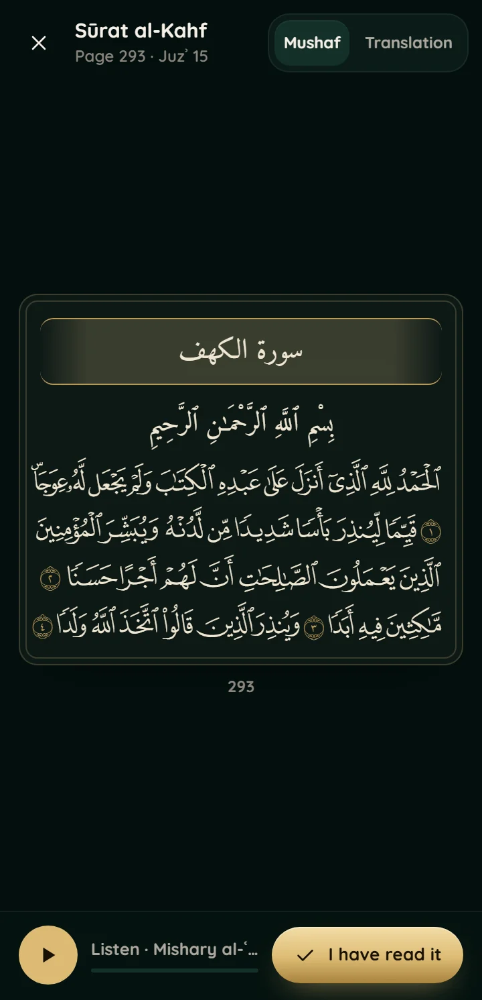</td>
<td width="33%">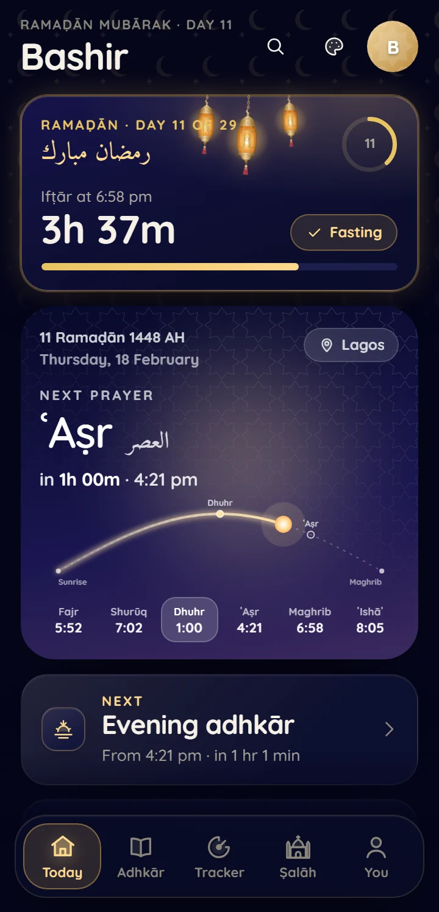</td>
</tr>
<tr>
<td><b>Every Friday</b><br>From Thursday Maghrib: its Sunnahs with their evidence, and the two hours of response.</td>
<td><b>Sūrat al-Kahf</b><br>On the Madinah muṣḥaf's own pages, with the translation and Mishary al-ʿAfāsī's recitation.</td>
<td><b>Ramaḍān, all month</b><br>Suḥūr and ifṭār, tarāwīḥ, the khatm and the last ten nights.</td>
</tr>
</table>

### On the computer

<table>
<tr>
<td width="50%">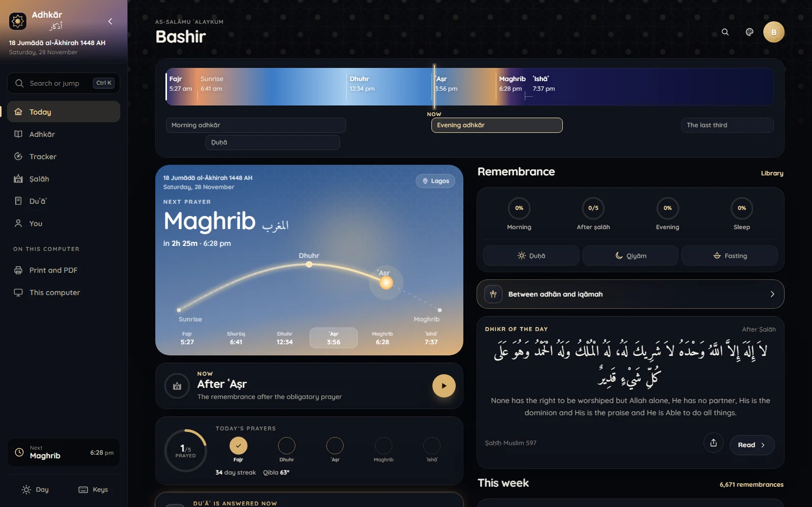</td>
<td width="50%">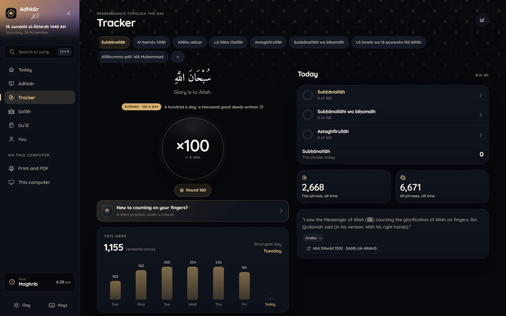</td>
</tr>
<tr>
<td><b>The whole day in one line</b><br>The day band runs from Fajr to the next Fajr: the morning adhkār until Dhuhr, the evening from ʿAṣr, Ḍuḥā and the last third.</td>
<td><b>Laid out for a big screen</b><br>Every page in deliberate columns: the counter with this week's real counts, today's numbers beside it.</td>
</tr>
<tr>
<td>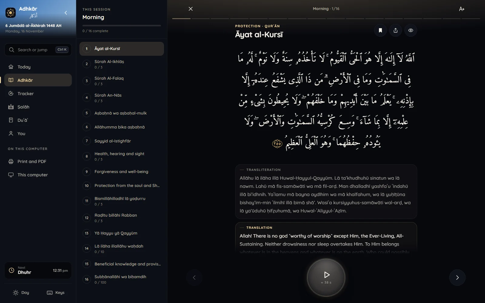</td>
<td>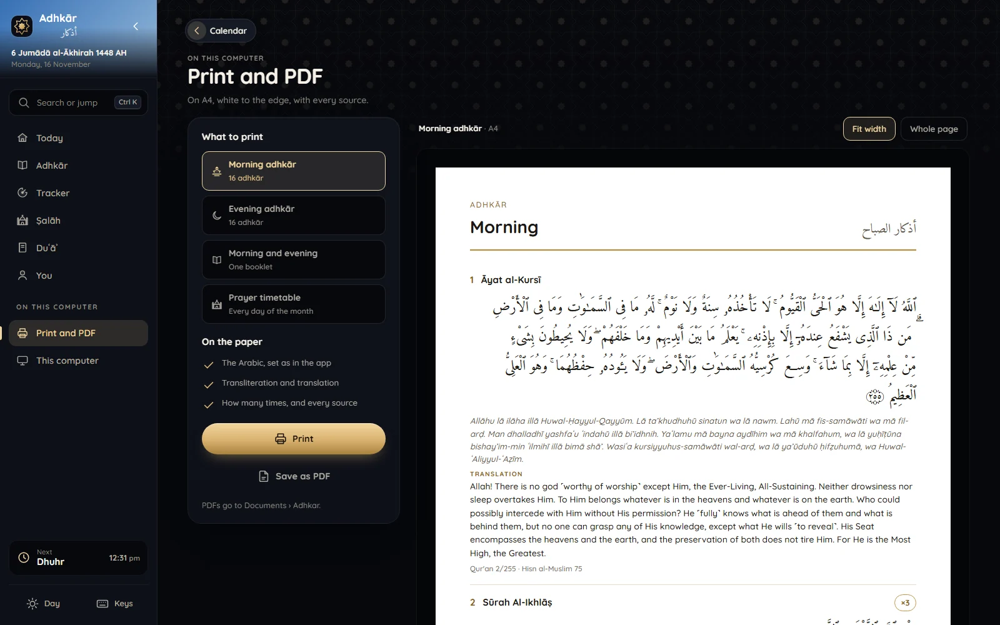</td>
</tr>
<tr>
<td><b>The session beside the reader</b><br>Every remembrance of the session in a list. Space counts; the arrow keys move; Ctrl K finds anything.</td>
<td><b>Print and PDF</b><br>The adhkār as an A4 booklet with every source, and the month's prayer timetable, white to the edge.</td>
</tr>
</table>

Also on Windows: **the pill**, a small capsule at the top of the screen like a notch that keeps the next prayer counting down while you work, even with the app minimised; reminders from the tray with the takbīr; thirty days of backups; and text size from 90% to 150%.

### By day, by night, and in Arabic

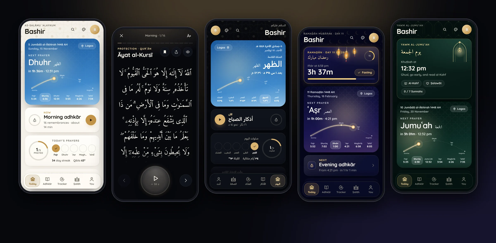

## How to use it

A simple path for the first week. The [illustrated guide](https://bashyr18.github.io/adhkar/guide/) shows every step on every screen.

1. **Install it** on your phone, your computer, or both ([Download](#download)).
2. **Begin.** Choose English or العربية, tell it your name, and choose your city or use your location. Prayer times are worked out on the device from then on.
3. **Learn to count on your fingers.** A practice of under a minute teaches the three gestures: tap to begin, tap to move on, hold to pause.
4. **Follow Today.** After Fajr it leads with the morning adhkār; from ʿAṣr, the evening. Tap the play key to begin a session.
5. **Log your prayers** by tapping each circle once you have prayed.
6. **Ask, at the times of answer.** Write your duʿāʾs in **Duʿāʾ**; the app reminds you at the last third of the night and the last hour of Friday, if you wish.
7. **Make it yours.** Under **You** are the theme and accent, Arabic size, prayer-time method, reminders, recitation downloads, backups and updates.

## Sources and privacy

- **Adhkār:** Arabic from the Ḥiṣn al-Muslim API (hisnmuslim.com); translation and transliteration from sunnah.com's Ḥiṣn al-Muslim.
- **Qurʾān:** the Uthmani text from Quran.com; the translation is *The Clear Quran* (Dr Mustafa Khattab), used with permission. Sūrat al-Kahf's page layout and fonts from the Quran.com API and the King Fahd Complex (QCF v2).
- **Hadith:** Arabic and the sunnah.com English from fawazahmed0/hadith-api, with grades as given on sunnah.com; only authentic narrations are used.
- **Recitations:** Ḥiṣn al-Muslim recordings and Mishary al-ʿAfāsī (everyayah.com), downloaded only when you ask.
- **Privacy:** no adverts, no analytics, no account. The only internet use is a recitation you choose to download, and the update check if you ask for it or turn it on.

Details, with every font and asset's terms, are in [NOTICE.md](NOTICE.md).

## Build it yourself

**You need:**
- JDK 17, Python 3, and Node 20 or newer;
- the Android SDK with `build-tools/36.0.0` and `platforms/android-36`.

```bash
cd tools/.node && npm ci && cd ../..   # once: Prettier and jsdom at the versions in package-lock.json
./build.sh                              # content, tests, bundle, then a signed dist/Adhkar.apk
```

`build.sh` runs, in order: the content builders, the content tests, the interface tests, the web bundle, then aapt2, javac, d8, zipalign and apksigner. It writes `dist/Adhkar.apk`, `dist/Adhkar.aab` for the Play Store (with `tools/.bin/bundletool.jar`; the bundle leaves out the self-update permission, since Play updates its own copies) and `dist/Adhkar.html`, the whole app in one file.

The version lives in one place, [`VERSION`](VERSION): the first line is the name people see, the second the code Android compares. Raise both for every release.

### Signing

The first build creates a key in `keystore/`. That folder is private and is **never** committed. Every update must be signed with the same key (the in-app updater and Android both check it), so keep a backup somewhere safe.

### Windows

On Windows 10 or 11, with Python 3 and Pillow:

```bash
python -I tools/build_windows.py        # bundles web/ and compiles dist/Adhkar-Windows.exe and dist/Adhkar-Setup.exe with the C# compiler built into Windows
```

The first run fetches the WebView2 SDK from nuget.org into `tools/.bin/`. No Visual Studio or .NET SDK is needed. `WIN_OUT=<path>` builds elsewhere, for when the app is running.

### The guide and these pictures

```bash
node tools/guide-shots.js               # every screenshot in the guide, from the app itself (phone, desktop, Friday, Ramaḍān)
node tools/cdp.js tools/guide-preview.js build/preview   # pictures of the guide (CDP_ORIGIN=file:///…/docs/guide/index.html)
python -I tools/readme_images.py        # docs/screens/*.webp, composed from those
```

### The promotional films

```bash
bash tools/promo/film.sh                # the 45-second film in 4:5, 9:16 and 16:9: tools/promo/ad.html drawn frame by frame, its sound cued by the picture
```

### Download counts

Once a day, `.github/workflows/stats.yml` keeps GitHub's release download counts in `docs/guide/stats.json` (`tools/download_stats.py`), as a ledger by file so counts survive a replaced file. The guide shows them.

## Tests

| Command | What it proves |
|---|---|
| `node tools/test.js` | Content: every item against its source, hadith grades, Sūrat al-Kahf's pages, prayer times against references, the JavaScript and Java prayer engines to the minute |
| `node tools/smoke.js` | The interface: boots the real app in jsdom in both languages, opens every screen and drives the actions |
| `node tools/bridge-check.js` | Every bridge method the Android app has also exists in the Windows app |
| `node tools/cdp.js tools/desk-sweep.js build/sweep` | Every desktop screen, in English and Arabic at 1333 × 790 and 1600 × 1000: script errors and anything wider than the window (`CDP_ORIGIN=file:///…/web/index.html?desk`) |
| `prettier --check` | Formatting, as the CI runs it |

All of them run on every push and pull request.

## Where things live

| Path | What |
|---|---|
| `web/` | The app: plain HTML, CSS and JavaScript, no framework. It also runs in a browser. |
| `web/js/core.js`, `ui.js`, `i18n.js` | State and saving, the router and rendering, the Arabic interface |
| `web/js/v-*.js` | One file per area of screens |
| `web/js/pace.js`, `prayer.js`, `audio.js`, `quiz.js`, `search.js`, `update.js` | The engines |
| `web/js/desk.js`, `web/desk.css` | The computer's layer: the rail, the day band, layouts, Ctrl K, print, the pill |
| `web/js/data.js`, `hadith.js`, `kahf.js` | **Generated** religious text. Never edit these; edit the build scripts |
| `android/` | The Android shell: a locked-down WebView, reminders, widgets, the tile, updates. No libraries |
| `windows/` | The Windows shell: WebView2, files and backups, PDF, the tray, the pill, updates |
| `docs/guide/` | The illustrated guide, published with GitHub Pages |
| `tools/` | Content builders, tests, screenshots, packers; `tools/promo/` the films |

## Contributing

See [CONTRIBUTING.md](CONTRIBUTING.md). Read the principles first: religious text is never typed by hand, translations are verbatim and labelled "Translation", and the Sunnah shapes the design.

## The maker

Made by **Bashir Badmus** as ṣadaqah jāriyah. Questions, ideas and corrections are welcome on [LinkedIn](https://www.linkedin.com/in/bashirbadmus/) or as a [GitHub issue](https://github.com/Bashyr18/adhkar/issues). Please remember the makers, and everyone whose work went into its sources, in your duʿāʾ.

## Licence

GPL-3.0 (see [LICENSE](LICENSE)). Content sources, fonts and assets keep their own terms: see [NOTICE.md](NOTICE.md).
