<div align="center">

# Adhkār

**Remembrance for every moment.**
A free Islamic app for Android and Windows: adhkār, prayer, Jumuʿah, Ramaḍān and the Hijri year, built as ṣadaqah jāriyah.
No ads, no account, no tracking.

[](https://github.com/Bashyr18/adhkar/releases/latest/download/Adhkar.apk)
[](https://github.com/Bashyr18/adhkar/releases/latest/download/Adhkar-Windows.exe)
[](https://bashyr18.github.io/adhkar/guide/)
[](https://www.linkedin.com/in/bashirbadmus/)

<br>

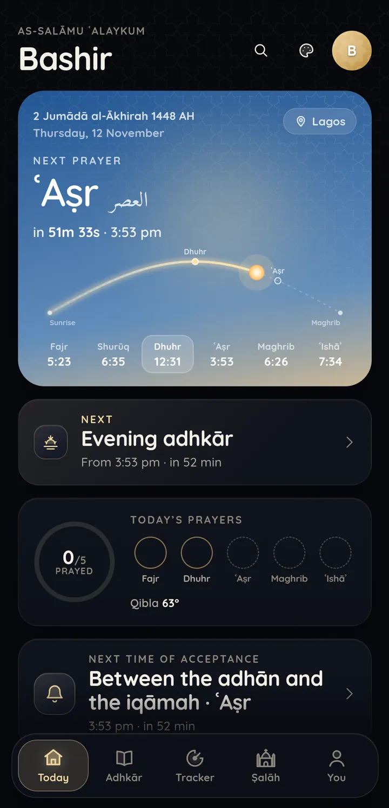&nbsp;
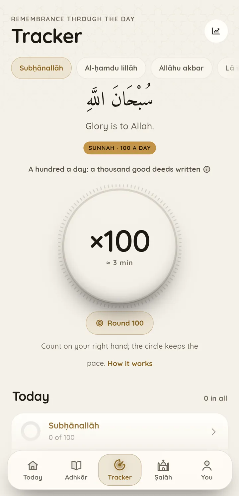&nbsp;
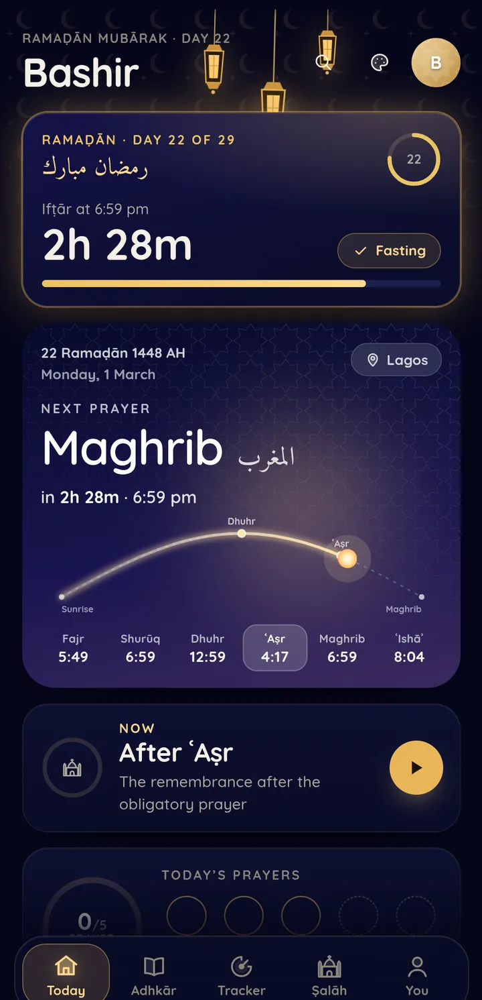&nbsp;
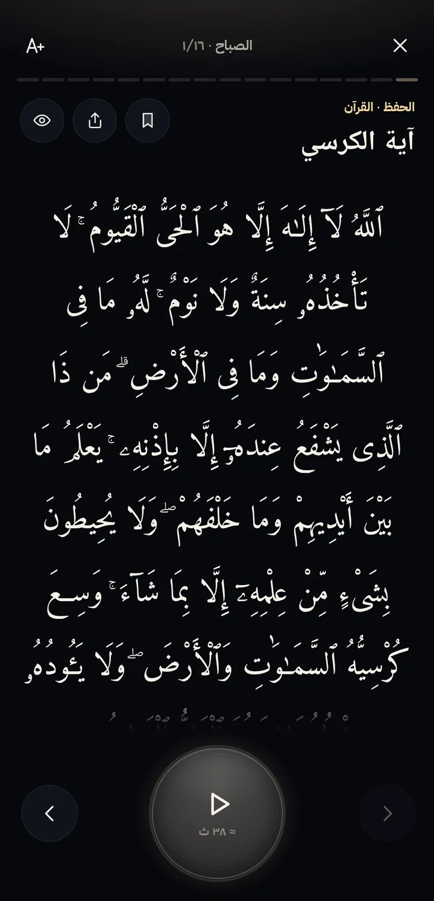

<sub>Today · the Tracker in light · Ramaḍān mode · the whole app in Arabic</sub>

</div>

---

## Contents

- [What it does](#what-it-does)
- [Install](#install): [Android](#android) · [Windows](#windows)
- [The illustrated guide](#the-illustrated-guide)
- [A tour of the app](#a-tour-of-the-app): [Today](#today) · [Adhkār](#adhkār-and-the-reader) · [Counting](#counting-on-your-fingers) · [Tracker](#the-tracker) · [Ṣalāh](#ṣalāh) · [Duʿāʾ](#duʿāʾ) · [Ramaḍān](#ramaḍān) · [Jumuʿah](#jumuʿah) · [You and settings](#you-and-settings) · [Widgets](#on-your-home-screen) · [Themes and Arabic](#themes-and-arabic)
- [Gestures](#gestures)
- [Privacy and sources](#privacy-and-sources)
- [For developers](#for-developers)
- [Made by](#made-by)

## What it does

| | |
|---|---|
| **Remembrance** | Morning and evening adhkār, after ṣalāh, sleep, waking, the night, the adhān, worry and distress, and everyday duʿāʾs. |
| **Prayer** | Prayer times calculated on the phone, the qibla, Ḍuḥā, qiyām, make-up prayers, iqāmah times, silence during ṣalāh, and a step-by-step guide to the prayer. |
| **Practice** | A Tracker with the numbers the Sunnah sets, counting on the fingers with a guided pace, a duʿāʾ journal, and a quiz that brings back what you miss. |
| **Jumuʿah** | A Friday mode from Thursday Maghrib to Friday Maghrib: its Sunnahs with their evidence, the two hours of response with an alert, and Sūrat al-Kahf on its Madani pages with recitation. |
| **On the phone** | Home-screen widgets, reminders at the minute, and the whole app in English or Arabic. |

Every Arabic text comes from a verified source, word for word. Translations are labelled "Translation", and every hadith carries its grade.

## Install

### Android

1. On your Android phone (Android 8 or later), download **[Adhkar.apk](https://github.com/Bashyr18/adhkar/releases/latest/download/Adhkar.apk)**.
2. Open the file. If your phone asks, allow installing apps from this source.
3. Open Adhkār, choose your city or use your location, and you are ready.
4. To update later, download the newest APK the same way. It installs over the old one and keeps everything you have recorded.

Every version is listed on the [releases page](https://github.com/Bashyr18/adhkar/releases), with what changed.

### Windows

<p align="center">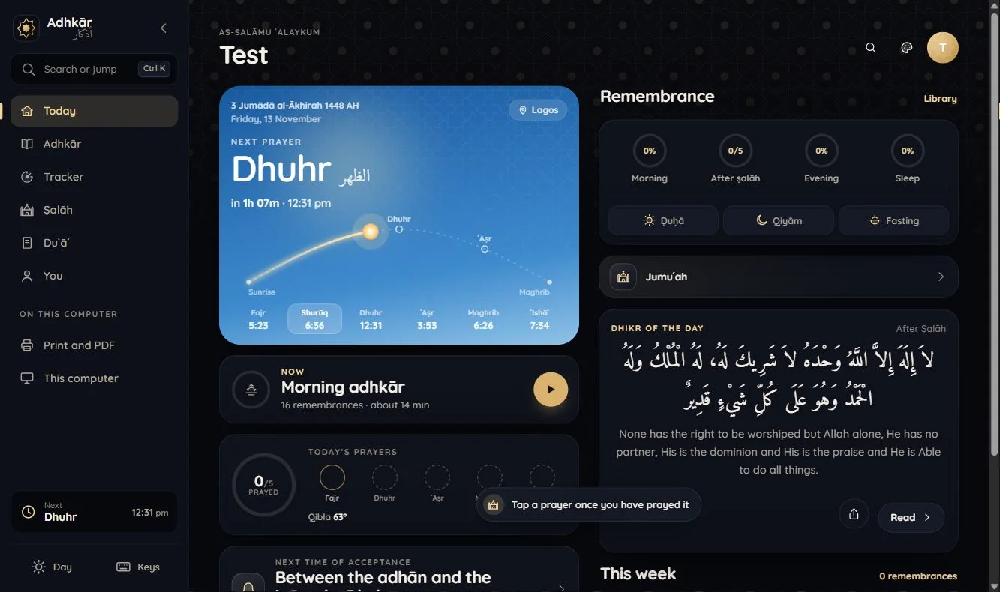</p>

1. On Windows 10 or 11, download **[Adhkar-Windows.exe](https://github.com/Bashyr18/adhkar/releases/latest/download/Adhkar-Windows.exe)**. It is one file, with nothing else to install.
2. Open it. Windows may say **"Windows protected your PC"** because the app is not yet signed: choose **More info › Run anyway**.
3. To keep it, open **This computer** in the rail and choose **Install**: Adhkār joins Start and your desktop, for you only, with no administrator needed. Remove it any time from Settings › Apps; your record stays.

What a computer adds:

- **The whole day at a glance:** Today opens with the day from Fajr to the next Fajr as a sky, each prayer marked, the times of the morning and evening adhkār, Ḍuḥā and the last third laid on it, and now marked. Click any part to open it.
- **The reader with its session beside it:** every remembrance of the session in a list with its count, the one you are on marked, any one a click away.
- **A rail with the sky of the hour** and today's Hijri and calendar dates, and **Ctrl K** to reach any remembrance, hadith, page or setting.
- **The keyboard:** Space taps the counting circle and holding it pauses, so counting on the fingers works as on the phone. ← and → move through the reader; F1 lists every shortcut.
- **Layouts made for the screen:** Today, Ṣalāh, the Tracker and You in two columns, and the reader at a comfortable width.
- **Print and PDF:** the morning and evening adhkār as a booklet with every source, and the month's prayer timetable, on A4.
- **Reminders from the tray**, with the takbīr of the adhān.
- **The pill:** a small capsule at the top of the screen, like a notch, that keeps the next prayer counting down while you work, even with Adhkār minimised. Rest the pointer on it to open the day: the Friday hours, the morning and evening adhkār, a fast you planned. Put it at the top, in a corner or anywhere, and choose its size and what it shows.
- **Learn the prayer as a spread:** the posture large on one side, its words and evidence beside it.
- **Backups:** one a day for 30 days, restorable, and a backup file dropped on the window comes in.

<p align="center">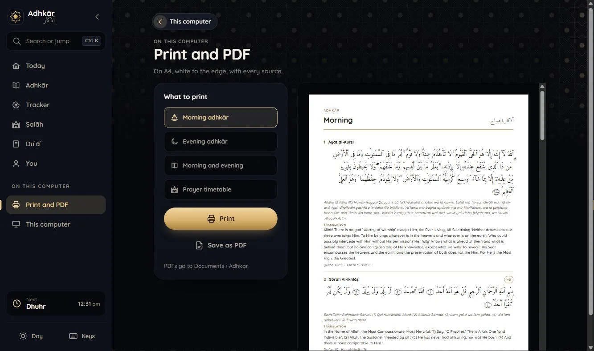&nbsp;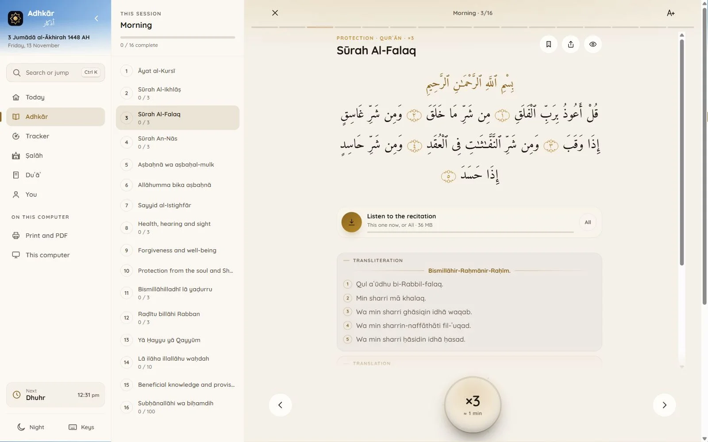</p>

Phone and computer syncing over home Wi-Fi comes next. Read [the plan](docs/windows-plan.md).

## The illustrated guide

<p align="center"><a href="https://bashyr18.github.io/adhkar/guide/">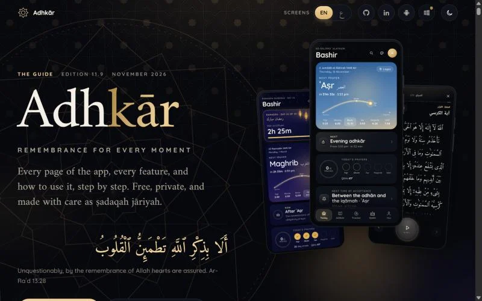</a></p>

**[Open the guide](https://bashyr18.github.io/adhkar/guide/)**: every page of the app, step by step, in a magazine-style web page that works on a phone or a computer.

- **Numbered markers** on each screen, matched to the steps beside it.
- **Walk me through** on any screen: it zooms to each part in turn and reads the step; **Take the guided tour** on the cover runs through the whole app.
- **Dark or light, English or Arabic:** switch the guide's theme, and see each screen in Arabic where it exists.
- **Tap any screen** to see it full size, then swipe or use the arrow keys to browse them all.

## A tour of the app

### Today

<table><tr>
<td width="240"></td>
<td>

Everything that matters right now.

1. **The sky card** shows the next prayer, a live countdown and the sun crossing the day. Today's five times sit beneath.
2. **Your place:** tap the location chip to change your city. Times are calculated on your phone, offline.
3. **Now, or Next** shows the one thing to do now, with a button to begin.
4. **Log your prayers:** tap a circle once you have prayed.
5. **The next time of acceptance**, from the Sunnah, live.

</td>
</tr></table>

### Adhkār and the reader

<p align="center">
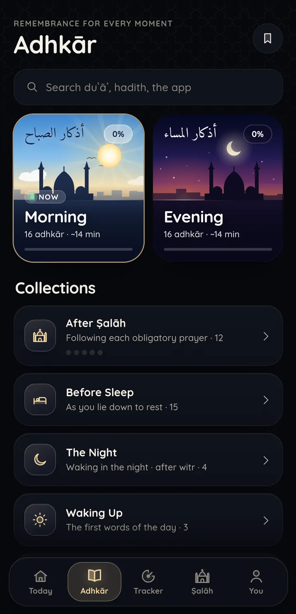&nbsp;
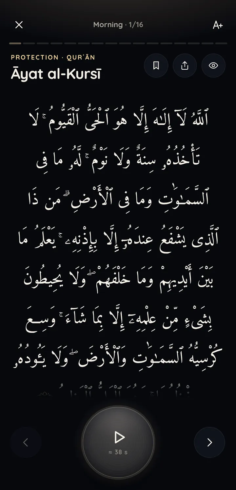
</p>

1. **Morning and Evening** sit at the top and show which is due now.
2. **Collections:** after ṣalāh, before sleep, the night, waking up and more.
3. **Search** in English or Arabic, with or without ḥarakāt.
4. **The reader** shows one remembrance at a time: the Arabic, then transliteration and translation.
5. **Listen**, **save**, **share**, or tap the eye to **memorise** by hiding the words.

### Counting on your fingers

<table><tr>
<td width="240">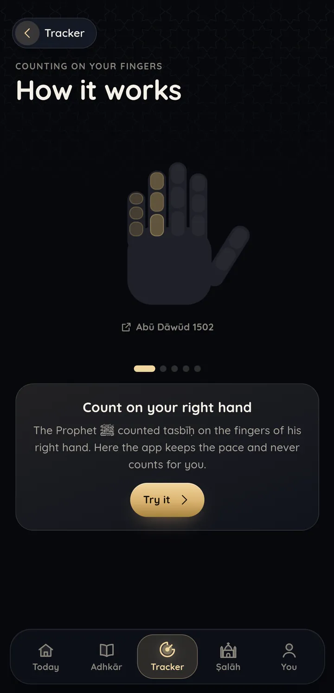</td>
<td>

The Prophet ﷺ counted tasbīḥ on the fingers of his right hand, so the app never counts for you. It keeps the pace while you count.

1. **Tap** the circle to begin, and count on your fingers.
2. **Tap again** if you finish a count sooner; the pace follows you.
3. **Hold** to pause; hold again to carry on.
4. **Confirm** at the end; nothing is recorded until you say you have finished.

A one-minute practice teaches this the first time you open the app.

</td>
</tr></table>

### The Tracker

<table><tr>
<td width="240">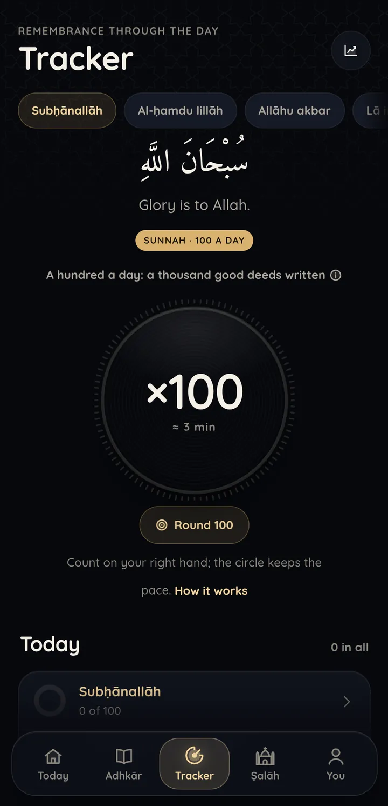</td>
<td>

Free remembrance, with the numbers the Sunnah sets.

1. **Choose a phrase**, or add your own with the plus.
2. **The gold tag** gives its Sunnah number; tap the line beneath for the hadith.
3. **The circle:** tap to begin a round and count on your fingers.
4. **Round size:** 100, or choose 33, 99 or 1,000.
5. **Today** shows each Sunnah number filling as you go; the chart button opens your history.

</td>
</tr></table>

### Ṣalāh

<p align="center">
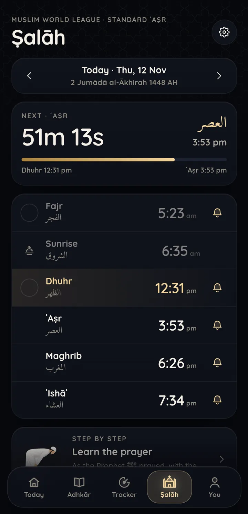&nbsp;
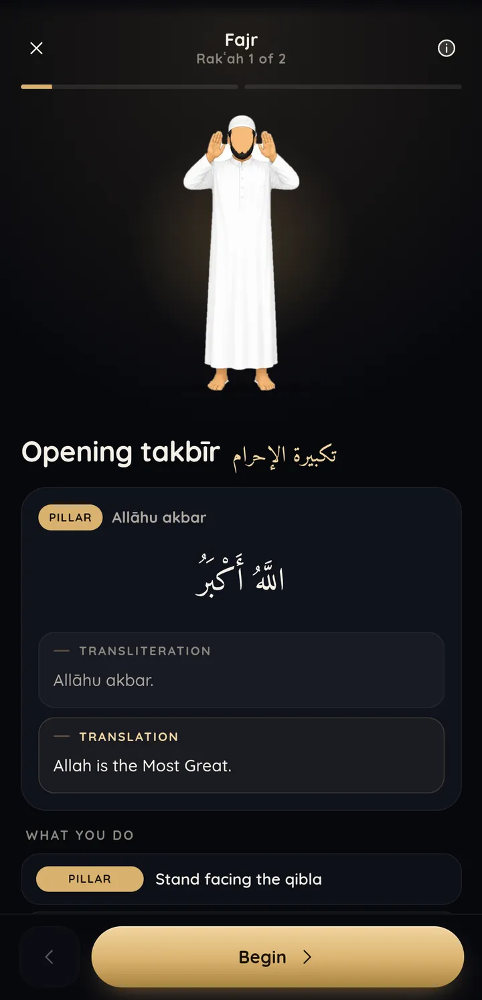
</p>

1. **Times for any day**, with the Hijri date and a countdown to the next prayer.
2. **Reminders:** each bell turns a prayer's reminder on or off, with the takbīr from Masjid an-Nabawī.
3. **Learn the prayer**, step by step from Fajr to Witr. Each act is marked as a pillar, an obligation or a sunnah, with its evidence.
4. **The qibla**, by compass or by the sun.
5. Also here: the month's timetable, the night, Ḍuḥā and make-up prayers.

### Duʿāʾ

<table><tr>
<td width="240">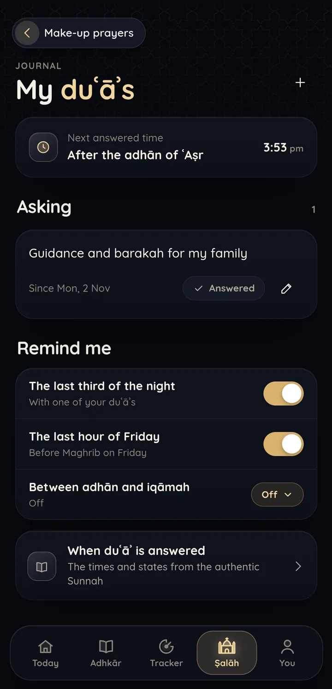</td>
<td>

1. **My duʿāʾs:** write what you are asking for, kept private, in any language.
2. **The next time of answer**, with gentle reminders at those times.
3. When Allah answers, tap **Answered** and note how.
4. **Small deeds:** light acts with heavy rewards, each with its hadith.

</td>
</tr></table>

### Ramaḍān

<p align="center">
&nbsp;
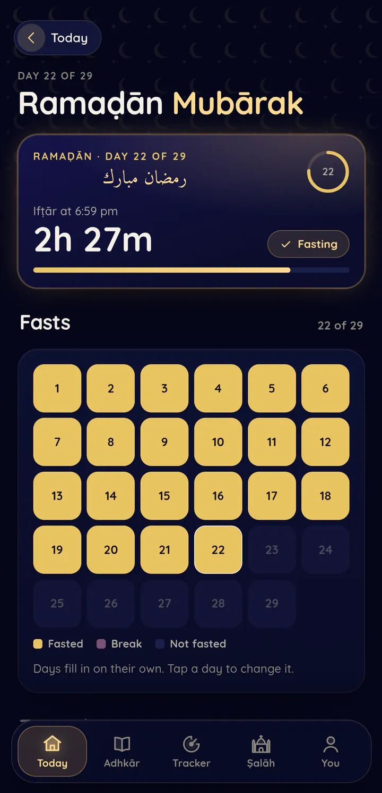
</p>

For the whole month the app changes with it, by itself.

1. **Lanterns and a night-indigo palette** across every tab.
2. **Ifṭār counting down**, and after Maghrib the end of suhūr.
3. **Fasts** fill in day by day; tap a day to change it.
4. **Tarāwīḥ**, a **khatm** of the Qurʾān by juzʾ, and **the last ten nights**.
5. Before the month, a countdown by the Umm al-Qurā calendar.

### Jumuʿah

<p align="center">
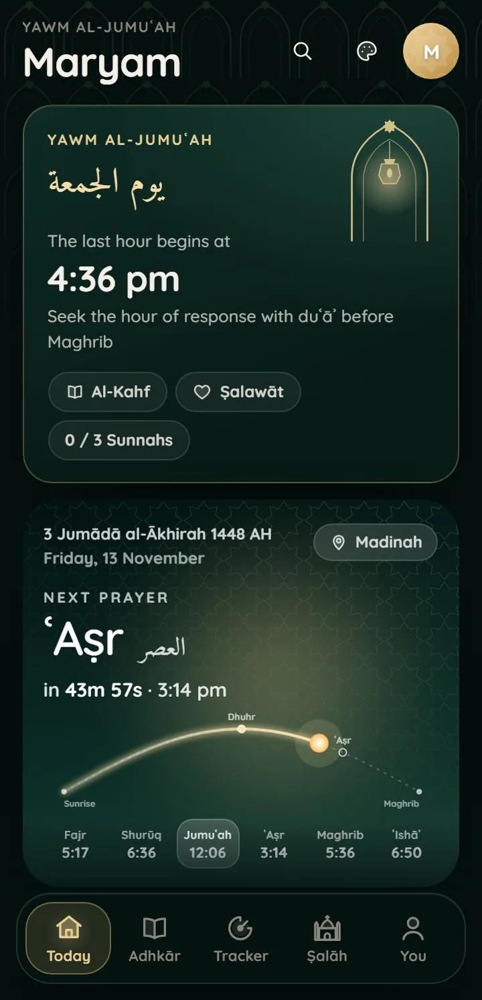&nbsp;
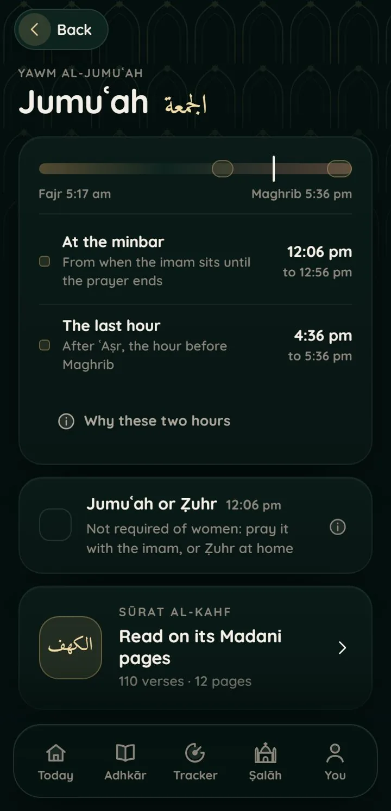&nbsp;
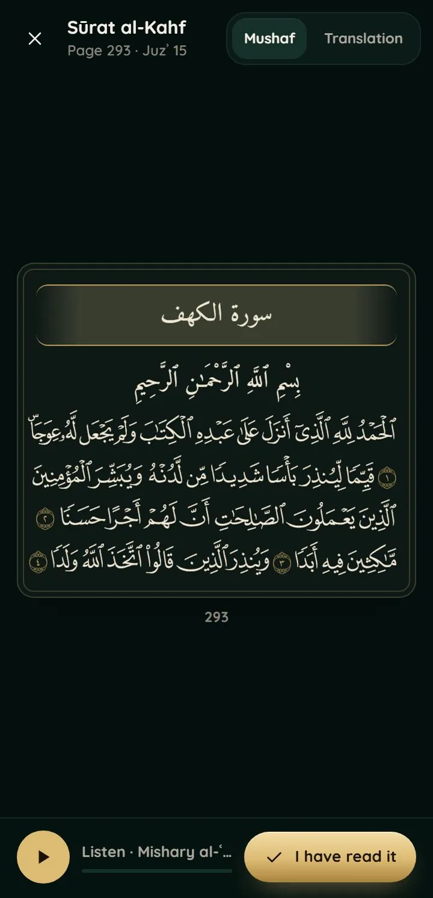
</p>

From Maghrib on Thursday to Maghrib on Friday the app wears an emerald night with gold arches.

1. **Today leads with the day:** what comes next (the khuṭbah, the last hour, Fajr), al-Kahf and ṣalawāt.
2. **The two hours of response:** from when the imam sits until the prayer ends (Muslim 853), and the last hour before Maghrib (Abū Dāwūd 1048). When the last hour begins, a card can appear over other apps.
3. **The prayer:** Jumuʿah in place of Ẓuhr for a brother; for a sister, who is not required to attend, Jumuʿah with the imam or Ẓuhr at home.
4. **The Sunnahs of the day,** each with its narration and grade: ghusl, siwāk and perfume, going early, listening in silence, abundant ṣalawāt, al-Kahf.
5. **Sūrat al-Kahf** on pages 293 to 304 of the Madinah Muṣḥaf, in the King Fahd Complex's page fonts, line for line; or verse by verse with The Clear Quran. Recited by Mishary al-ʿAfāsī, the reciting verse lit and the page turning with it.

A day that has not come can't be logged as fasted: tap it in the calendar to **plan the fast**, with a reminder at Maghrib the evening before. And under You, **Print and PDF** puts the adhkār booklet and the timetable on paper from the phone too.

### You and settings

<table><tr>
<td width="240">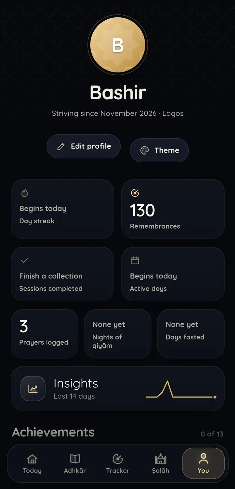</td>
<td>

1. **Your figures:** streak, remembrances, sessions and active days, compared with no one.
2. **Insights:** your remembrance by day, by time and by phrase.
3. **Settings**, under You: appearance, reading, prayer times, reminders, widgets, and backup.
4. **Backup and data:** export, import, or erase everything.

</td>
</tr></table>

### On your home screen

<p align="center">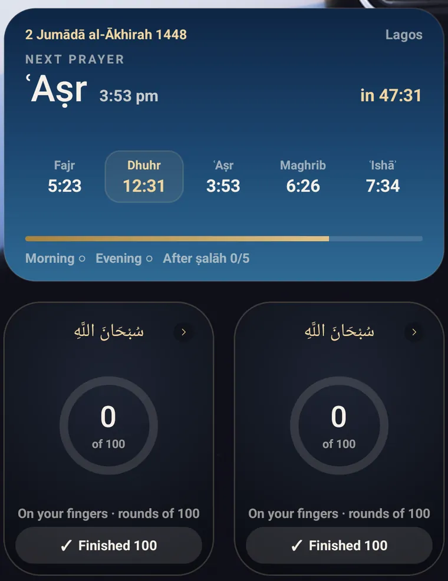</p>

- **The prayer widget:** the next prayer with a live countdown. Tap a prayer you have prayed to log it.
- **The Tracker widget:** tap **Finished 100**, then again to confirm, after a round on your fingers.
- **Add them:** long-press your home screen, then Widgets › Adhkār. There is also a quick settings tile and app shortcuts.

### Themes and Arabic

<p align="center">
&nbsp;
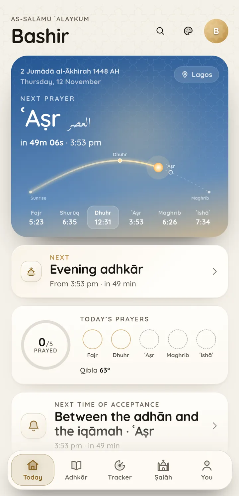&nbsp;
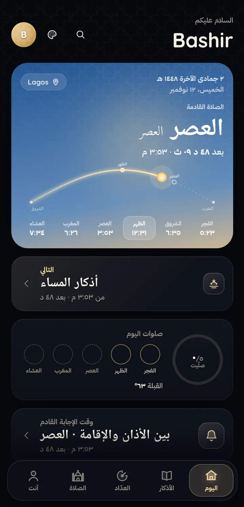
</p>

- **Auto, Dark or Light** from the palette button on Today. Auto follows your phone.
- **Five accents:** gold, emerald, sapphire, rose and pearl.
- **The whole app in Arabic:** You › Appearance › Language › العربية. The layout turns right to left, and notifications and widgets follow.

## Gestures

| Gesture | What it does |
|---|---|
| Tap the circle | Moves on at once when you finish a count early. |
| Hold the circle | Pauses; hold again to carry on. |
| Swipe sideways | Moves between Today, Adhkār, Tracker, Ṣalāh and You. |
| Swipe from the edge | Goes back. |

## Privacy and sources

- **Private:** no account, no analytics. Everything stays on your phone.
- **Offline:** prayer times are calculated on the phone. The internet is used only for recitations you choose to download.
- **Sources:** Arabic adhkār from Ḥiṣn al-Muslim; translations verbatim from sunnah.com and The Clear Quran; every hadith with its grade from sunnah.com. Sūrat al-Kahf's text, page layout and page fonts from the Quran.com API and the King Fahd Complex (QCF v2); its recitation from everyayah.com. Details are in [Content](#content) and [NOTICE.md](NOTICE.md).

---

## For developers

### Principles

Read these before changing anything. They are why the app is shaped the way it is.

1. **Religious text is never typed by hand.** Arabic and translations come from verified sources, through the build scripts in `tools/`, verbatim. See [Content](#content).
2. **Translations are labelled "Translation" and are verbatim:** sunnah.com for adhkār and hadith, The Clear Quran for the Qurʾān. Hadith carry their grade; only authentic narrations are used.
3. **The Sunnah shapes the design.** For example, dhikr is counted on the fingers by default, so the app keeps the pace rather than counting for you.
4. **Audio plays exactly what is on screen.** Where no recording of the exact words exists, the app says so.
5. **Prove it works.** Every change runs the content tests and the interface tests; screens are checked on a device.

### Layout

| Path | What |
|---|---|
| `web/` | The app: plain HTML, CSS and JavaScript, no framework. It also runs in a browser. |
| `web/js/core.js` | State, saved data, the catalogue of content, the bridge to Android. |
| `web/js/ui.js` | Router, rendering, sheets, gestures, theme. |
| `web/js/i18n.js` | The Arabic interface: formatters, the dictionary, number patterns. |
| `web/js/v-*.js` | One file per area of screens. |
| `web/js/pace.js`, `quiz.js`, `search.js`, `prayer.js`, `audio.js` | The engines. |
| `web/js/data.js`, `web/js/hadith.js` | **Generated** religious text. Never edit these; edit the build scripts. |
| `android/` | The native shell: a locked-down WebView, the bridge, reminders, widgets, the quick settings tile. No libraries. |
| `tools/` | Content builders, fetchers, tests, packers. |
| `docs/` | The illustrated user guide, published with GitHub Pages. |
| `store/` | Play Store listing and privacy policy. |

`web/js/prayer.js` is mirrored in `android/src/com/adhkar/app/PrayerCalc.java` (reminders and widgets use the Java one). The tests compare the two to the minute; change both together.

### Build

```bash
./build.sh
```

Needs JDK 17, Python 3, Node 20 or later, and the Android SDK (`build-tools/36.0.0`, `platforms/android-36`). The first time, install the Node tools:

```bash
cd tools/.node && npm ci
```

`build.sh` runs, in order: the content builders, the content tests, the interface tests, the web bundle, then aapt2, javac, d8, zipalign and apksigner. It writes:

- `dist/Adhkar.apk`: the signed app.
- `dist/Adhkar.aab`: the Play Store bundle (needs `tools/.bin/bundletool.jar`).
- `dist/Adhkar.html`: the whole app in one file, for testing in a browser.

The version lives in one place, the `VERSION` file: its first line is the name people see, the second is the code Android compares. Raise both for every release.

**Signing.** The first build creates a key in `keystore/`. That folder is private and is never committed. Every update must be signed with the same key, so keep a backup of it somewhere safe.

### Tests

```bash
node tools/test.js     # content: every item, hadith grades, prayer times against references, JS/Java parity
node tools/smoke.js    # interface: boots the real app in jsdom, opens every screen, drives the actions
```

Both run on every build and on every pull request. Write a test for each behaviour you add, named as a sentence about what the person using the app experiences.

### Content

```
tools/fetch_*.py      → tools/src/*.json            raw sources, kept as fetched
tools/build_content.py → web/js/data.js             adhkār, Qurʾān passages, the Tracker phrases
tools/build_hadith.py  → web/js/hadith.js           hadith, sliced verbatim between two markers
```

- **Adhkār:** Arabic from the Ḥiṣn al-Muslim API (hisnmuslim.com); translation and transliteration from sunnah.com's Ḥiṣn al-Muslim.
- **Qurʾān:** the Uthmani text from Quran.com; the translation is The Clear Quran (Dr Mustafa Khattab), used with permission.
- **Hadith:** Arabic and the sunnah.com English from fawazahmed0/hadith-api; grades as given on sunnah.com.
- **Recitations:** Ḥiṣn al-Muslim recordings (hisnmuslim.com) and Mishary al-ʿAfāsī (everyayah.com), downloaded by the app on request.

Every deliberate change to a source text is written down in code, with its reason: `FIX` (a correction) and `NOTE` (an explanation shown beside the text, never mixed into it) in `tools/build_hadith.py`.

### Contributing

See [CONTRIBUTING.md](CONTRIBUTING.md).

## Made by

Adhkār is made as ṣadaqah jāriyah. To get in touch, or to follow what comes next, find the maker on **[LinkedIn](https://www.linkedin.com/in/bashirbadmus/)**. Please remember the makers, and everyone whose work went into its sources, in your duʿāʾ.

## Licence

GPL-3.0 (see [LICENSE](LICENSE)). Content sources, fonts and assets keep their own terms: see [NOTICE.md](NOTICE.md).
